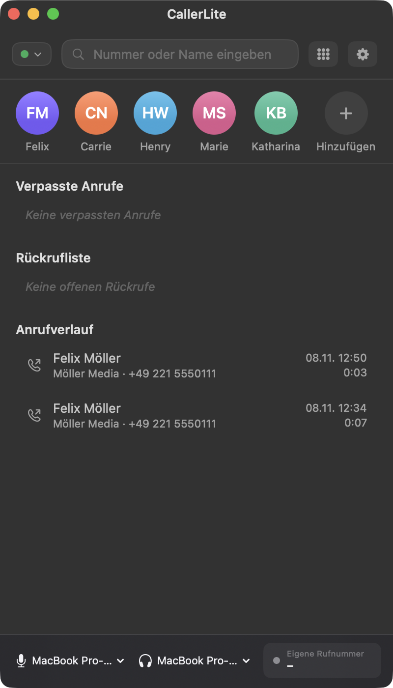

# CallerLite

A native macOS SIP softphone built with SwiftUI. CallerLite combines a clean, dark UI with a pure-Swift SIP/RTP stack — no external SIP libraries.



## Features

- **SIP over UDP** with Digest authentication (MD5)
  - REGISTER with 401 challenge handling
  - INVITE / ACK / BYE / CANCEL, re-INVITE for hold, REFER-based transfer
  - Correct non-2xx ACK handling (reuses the INVITE Via branch, RFC 3261 §17.1.1.3)
  - INVITE transaction timeout triggers CANCEL
- **Optional registrar**: route registration and call traffic through a dedicated registrar (`host[:port]`), while `server` stays the SIP domain in URIs
- **Media**: G.711 (PCMU/PCMA) over RTP, RFC 2833 DTMF, AVAudioEngine-based audio
  - Permission-aware: falls back to output-only when microphone access is denied
- **Calls**: incoming/outgoing calls, hold, transfer, mute, DTMF keypad
- **Phone book**: favorites, add-favorite sheet, contact search
- **Contact avatars**: choose one of the built-in person emojis (Apple Color Emoji) or pick your own photo
- **Call management**: history, missed calls, callback list
- **Availability**: available / away / busy / do-not-disturb; busy and DND silently reject incoming calls (486) and record a missed call
- **Demo mode**: simulated calls without a server (enabled by default)
- **Persistence**: contacts, history, callbacks and handled calls stored as JSON; SIP password stored in the macOS Keychain
- **Localization**: German UI, dark appearance
- **App icon** authored with Icon Composer, compiled into the bundle via `actool`

## Requirements

- macOS 13 or later (developed and tested on macOS 26)
- Swift 5.9+ toolchain (tested with Swift 6.4)
- Xcode (provides `actool`, used by the bundle build to compile the icon)

## Build & Run

```sh
# Compile the Swift package
swift build

# Build and codesign the .app bundle (debug or release, default: release)
./Scripts/build-app.sh
./Scripts/build-app.sh debug

# Launch
open dist/CallerLite.app
```

The bundle build:

- compiles the executable,
- writes `Contents/Info.plist` (bundle name, version, microphone usage, copyright),
- compiles `Resources/CallerLite.icon` into `Assets.car` + `CallerLite.icns` with `actool`,
- ad-hoc codesigns the bundle.

## Tests

```sh
swift test
```

16 tests: unit tests for the SIP message parser, digest auth, SDP, G.711, plus an end-to-end integration test against a local mock SIP server — including a regression test for the 407/401 re-INVITE ACK branch bug and registrar host:port parsing.

## Configuration

Open the settings with the gear button in the main window:

| Setting | Defaults key | Notes |
| --- | --- | --- |
| Server | `sip.server` | SIP domain / host used in URIs |
| Port (UDP) | `sip.port` | default `5060` |
| Registrar (optional) | `sip.registrar` | `host[:port]`; empty = use server |
| Username | `sip.username` | |
| Password | Keychain (`sip.password`) | service `de.sipphone.mac` |
| Display name | `sip.displayName` | |
| Own number | `sip.ownNumber` | |
| Demo mode | `demoMode` | simulated calls, no network |

Availability is persisted under `sip.availability`.

User data is stored in `~/Library/Application Support/SIPPhone/`:

- `contacts.json`
- `history.json`
- `callbacks.json`
- `handled.json`
- `Avatars/` — contact photos (PNG, scaled to 512×512)

> The bundle identifier `de.sipphone.mac` and the data folder name `SIPPhone` are kept stable for backwards compatibility with existing user data, even though the app is called CallerLite.

## Project Structure

```
Sources/
  SIPPhone/                 # @main App entry point (WindowGroup, menus, AppDelegate)
  SIPPhoneCore/
    AppModel.swift          # Wires SIP client, contact store, devices, calls
    CallManager.swift       # Call state machine, availability, persistence
    ContactStore.swift      # Favorites/contacts
    Models.swift            # Contact, CallRecord, Availability, ...
    Persistence.swift       # JSONStore
    Keychain.swift
    AudioDevices.swift
    SIP/
      SIPClient.swift       # Protocol between UI and SIP implementations
      RealSIPClient.swift   # SIP over UDP stack (registrar, transactions, ACK/CANCEL)
      DemoSIPClient.swift   # Simulated calls for demo mode
      SIPMessage.swift      # Message parser/serializer
      DigestAuth.swift      # MD5 digest auth
      SDP.swift             # SDP offer/answer
      G711.swift            # PCMU/PCMA codecs
      RTPSession.swift      # RTP packetization
      UDPSocket.swift       # GCD-based UDP socket
      AudioIO.swift         # AVAudioEngine capture/playback
    Views/                  # SwiftUI views (main window, overlay, keypad, settings, ...)
Resources/
  CallerLite.icon/             # Icon Composer document (compiled by actool)
Scripts/
  build-app.sh              # Bundle build + icon compilation + codesign
Tests/
  SIPPhoneTests/            # Unit + integration tests
```

## Limitations

- UDP transport only; no TLS/SRTP
- G.711 only (no Opus/G.722)
- Single SIP account
- Transfer uses REFER (not attended transfer)

## Copyright

Copyright © 2026 – Adam Moczydlowski
Alle Rechte vorbehalten.

Private repository — all rights reserved.
